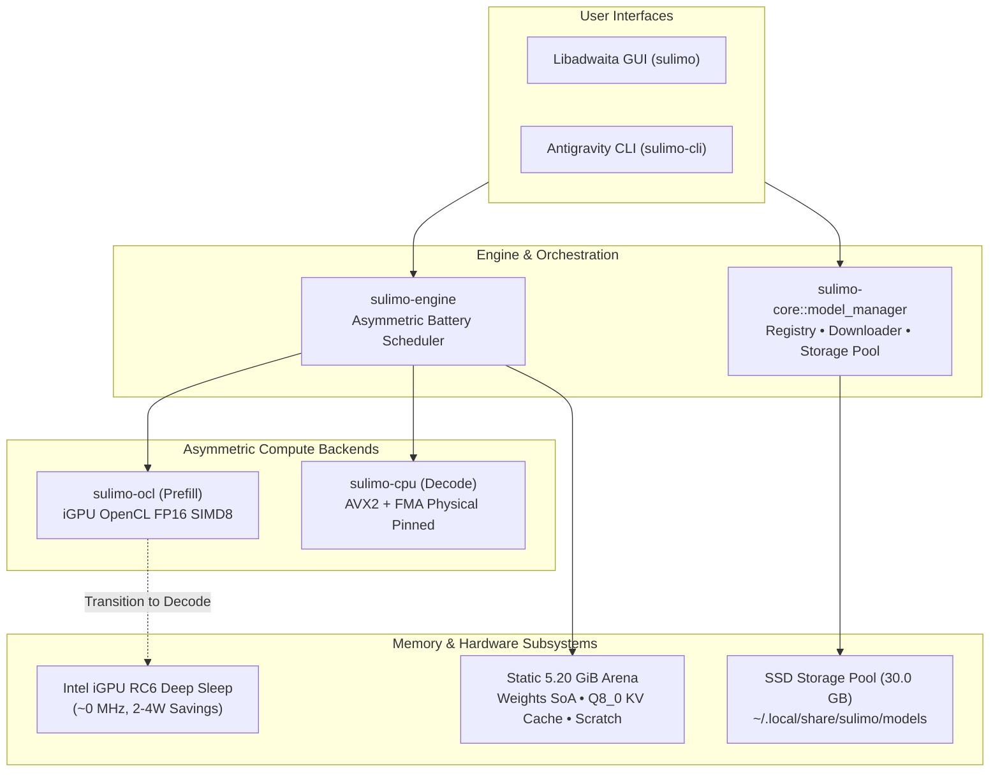
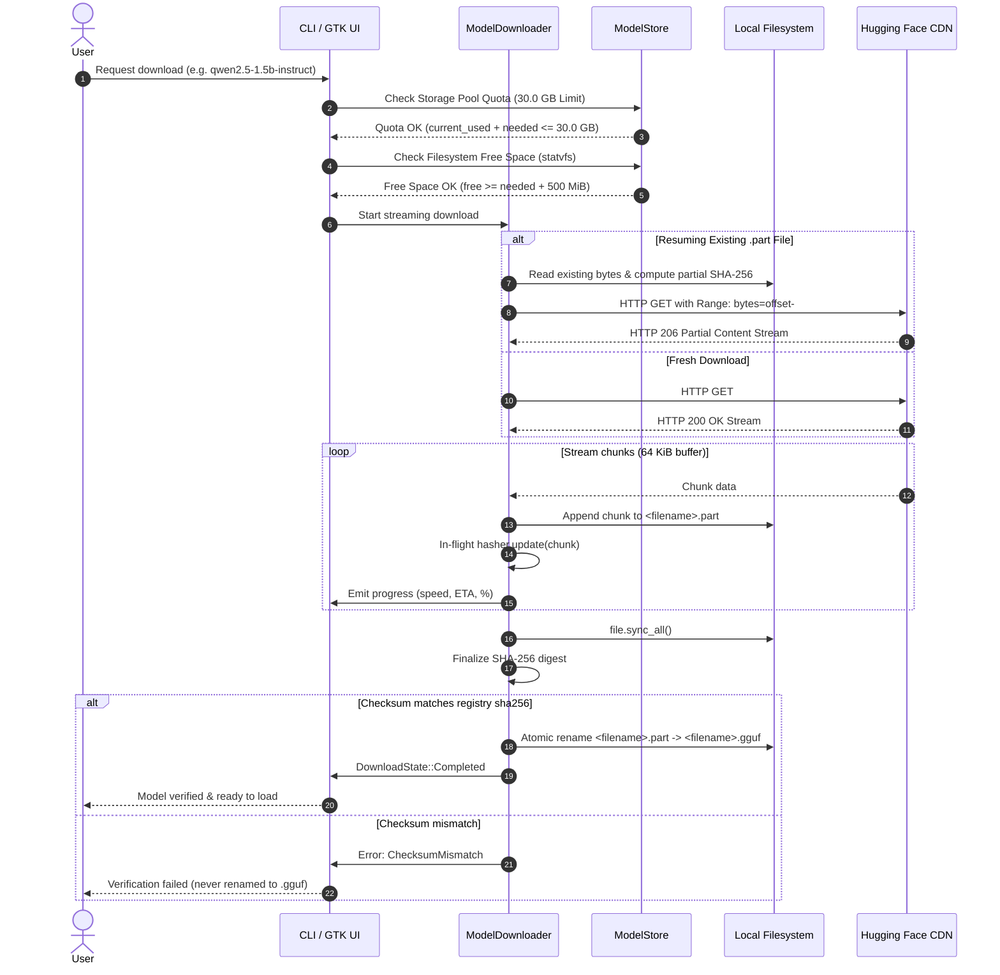

# Súlimo System Architecture & Design Specification

Súlimo is an asymmetric, battery-disciplined Large Language Model (LLM) engine and dual-interface client (native GNOME Libadwaita GUI and Antigravity-style CLI) written in Rust.

It is engineered for legacy thin-and-light laptop hardware—specifically Intel 5th through 10th Gen architectures (Broadwell through Comet Lake / Ice Lake)—operating under strict physical constraints: **8 GB of shared system RAM** and a **256 GB host SSD**.



---

## 1. Subsystem & Crate Breakdown

```text
Sulimo/
├── crates/
│   ├── sulimo-core/     # GGUF v3 parser, static arena allocator, Q8_0 KV cache,
│   │                    # Model manager (curated registry, downloader, store)
│   ├── sulimo-cpu/      # AVX2+FMA vector kernels, physical core affinity pinning, thread pool
│   ├── sulimo-ocl/      # OpenCL runtime prober, FP16 SIMD8 GEMM & prefill kernels, zero-spin sync
│   ├── sulimo-engine/   # Asymmetric battery scheduler, forward pass pipeline, capability prober
│   ├── sulimo-cli/      # Antigravity-style interactive REPL, slash commands, CLI model manager
│   └── sulimo-gtk/      # Libadwaita desktop application, telemetry bar, Model Manager dialog
├── docs/
│   └── models.md        # Curated model catalog, architecture specifications, hardware envelopes
├── scripts/
│   └── check.sh         # Complete workspace CI script (fmt, clippy, test suite)
└── README.md
```

### `crates/sulimo-core`
- **GGUF v3 Parser**: Memory-mapped (`memmap2`) zero-copy parser extracting architecture hyperparameters, tensor descriptors, and quantization blocks.
- **Static Arena Allocator (`Arena`)**: Continuous, page-aligned static memory arena pre-allocated at load time. All tensor data, activation scratchpads, and circular KV caches reside within this arena.
- **Q8_0 Circular KV Cache**: Quantized ring buffer preserving context across conversational turns with bounded memory growth.
- **Byte-Level BPE Tokenizer**: Deterministic byte-fallback BPE tokenizer supporting ChatML, Llama-3, and Gemma prompt formats.
- **Model Management Subsystem (`model_manager`)**:
  - `registry.rs`: Curated catalog of 12 verified local models with exact LFS sizes and SHA-256 digests.
  - `store.rs`: Local model repository managing `~/.local/share/sulimo/models`, enforcing the 30.0 GB storage budget, and querying filesystem free space via `libc::statvfs`.
  - `downloader.rs`: Resumable streaming HTTP client writing to `<file>.part` with in-flight SHA-256 hashing and atomic rename to `.gguf`.

### `crates/sulimo-cpu`
- **AVX2 + FMA Vector Kernels**:
  - `rmsnorm_scalar` / `rmsnorm_avx2`: Standard Root Mean Square Layer Normalization.
  - `rmsnorm_gemma_scalar` / `rmsnorm_gemma_avx2`: Gemma 2 dual RMSNorm with `x * (1 + weight)` scaling.
  - `logit_softcap_scalar`: Attention and final logit soft-capping via $\tanh(x / \text{cap}) \cdot \text{cap}$.
  - `geglu_scalar`: Gated GELU non-linearities for Gemma 2 FFN blocks.
  - `dequantize_q4_0_soa` / dot product vectorization.
- **Physical Core Affinity Pinning**: Probes `/sys/devices/system/cpu` to identify physical cores vs hyperthreads, strictly pinning decode threads to physical cores to avoid thermal throttling and thread contention.

### `crates/sulimo-ocl`
- **OpenCL Runtime Prober**: Interrogates Intel NEO OpenCL drivers, detecting FP16 (`cl_khr_fp16`), subgroup SIMD8 support, and local memory sizing.
- **FP16 SIMD8 Prefill GEMM**: Accelerates initial prompt ingestion by executing matrix-matrix multiplication on integrated GPU execution units (EUs) using zero-copy shared host pointers.
- **Zero-Spin Synchronization**: Replaces busy-wait polling with POSIX condition variables and OpenCL event callbacks, allowing the CPU to sleep during GPU prefill.

### `crates/sulimo-engine`
- **Asymmetric Battery Scheduler**: Coordinates the two-phase lifecycle:
  1. *Prompt Prefill*: Dispatches context to iGPU via OpenCL FP16 SIMD8.
  2. *Handover & Decode*: Hands over KV cache pointers to physical CPU threads via zero-copy. The iGPU execution pipeline drops to 0 MHz, entering Intel **RC6 deep sleep** and saving 2–4W throughout token generation.
- **Zero-Allocation Hot Path**: The autoregressive token decode loop performs **0 bytes of heap allocation**. All intermediate states borrow slices from the static scratch arena.

### `crates/sulimo-cli`
- **Antigravity Terminal Interface**: Authentic cyber-retro terminal aesthetic with neon/slate palettes, live telemetry cards, and multi-turn context repacking.
- **Model Management Commands**: `sulimo-cli models [list|search|download|remove|verify]`.
- **Auto-Download Hook**: Seamlessly prompts to download and verify missing models when executing `sulimo-cli run <id>`.

### `crates/sulimo-gtk`
- **Libadwaita GUI**: Clean, modern GNOME interface with dark/light theme integration.
- **Frame-Budget Coalescer**: Coalesces high-throughput token streams to 60 FPS (~16 ms frames), eliminating UI jitter and stutter.
- **Scroll-Pause Detection**: Scrolling up through conversation history automatically decouples auto-scroll so reading is never interrupted by incoming tokens.
- **Model Manager Dialog (`ModelManagerDialog`)**: Native preferences dialog displaying dedicated SSD storage pool progress, curated model cards, background streaming downloads, and instant deletion.

---

## 2. Model Management & Storage Architecture



---

## 3. Strict Hardware Invariants

| Constraint | Enforcement Mechanism | Purpose |
|---|---|---|
| **5.20 GiB Unified RAM Ceiling** | `sulimo_core::budget::MemoryBudget` | Prevents kernel OOM kills and swap thrashing on 8 GB systems. |
| **30.0 GB SSD Model Storage Pool** | `sulimo_core::model_manager::ModelStore` | Guarantees Súlimo models never consume more than 30.0 GB on a 256 GB drive. |
| **500 MiB Filesystem Safety Headroom** | `libc::statvfs` pre-flight check | Ensures host operating system never runs out of emergency disk space. |
| **Zero Heap Allocations on Hot Path** | `ArenaSlice` static pre-allocation | Zero GC/allocator jitter during autoregressive token decode. |
| **Physical Core Pinning** | `sched_setaffinity` in `sulimo-cpu` | Eliminates hyperthread resource contention and reduces CPU package thermals. |
| **iGPU RC6 Sleep Residency** | Asymmetric scheduler decode split | Saves 2–4W of battery by parking the iGPU at ~0 MHz during token generation. |
